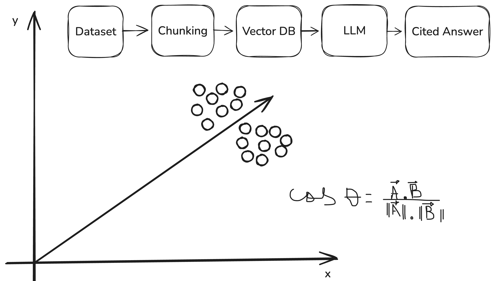

# Mini RAG



A minimal local RAG (Retrieval-Augmented Generation) system that answers questions about documents using Ollama.

No cloud API keys required.

## What is RAG?

RAG (Retrieval-Augmented Generation) is a technique that combines information retrieval with text generation.

Instead of relying only on the knowledge learned during training, the model first retrieves relevant information from a document collection and uses it as context to generate an answer.

In this project:

- **Retrieval:** Finds relevant content in local Markdown documents.
- **Augmentation:** Adds the retrieved content to the question as context.
- **Generation:** Uses an LLM to generate an answer based on that context.

## Requirements

- Python 3.14+
- [uv](<https://docs.astral.sh/uv/>)
- [Ollama](<https://ollama.com/>)

## Setup

Install dependencies:

```bash
uv sync
```

Download the required models:

```bash
ollama pull qwen3:4b-instruct
ollama pull nomic-embed-text
```

Start Ollama:

```bash
ollama serve
```

## Usage

Run the CLI:

```bash
uv run mini-rag
```

## How it works

1. **Chunking:** Markdown documents are split into smaller text segments called chunks.
2. **Embedding:** Each chunk is converted into a numerical vector that represents its semantic meaning.
3. **Retrieval:** The question is also converted into a vector. The system compares it against the document vectors using cosine similarity.
4. **Ranking:** Chunks with higher similarity scores are considered more relevant. The three most relevant chunks are selected.
5. **Generation:** The selected chunks are sent to the LLM along with the question to generate an answer.

### What is cosine similarity?

Cosine similarity measures how similar two vectors are by calculating the cosine of the angle between them.

In this project, it helps estimate how semantically related a question is to a document chunk.

- **1:** Vectors point in the same direction (high similarity).
- **0:** Vectors are perpendicular (no directional similarity).
- **-1:** Vectors point in opposite directions.

The closer the score is to 1, the more similar the vectors are.

## Adding documents

Place new `.md` files in `docs/` and restart the application.

The index is rebuilt on every startup.

## Configuration

Models and Ollama URL can be changed in `src/mini_rag/config.py`.

## Limitations

- No persistent index.
- Basic paragraph-based chunking.
